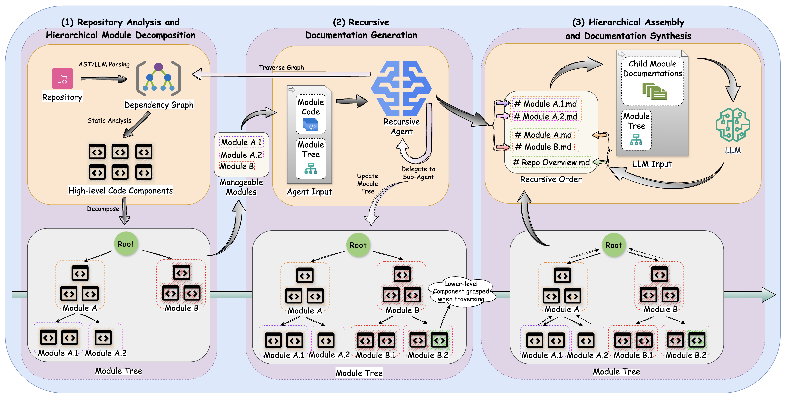
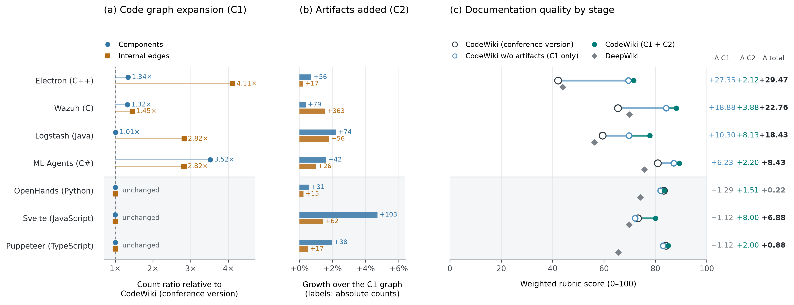

<p align="center">
  <picture>
    <source media="(prefers-color-scheme: dark)" srcset="./img/black-background-logo.png">
    
  </picture>
</p>

<p align="center">
  <strong>基于依赖关系图，为大型代码仓库生成可追溯的项目文档。</strong>
</p>

<p align="center">
  <a href="https://python.org/"></a>
  
  <a href="./LICENSE"></a>
  <a href="https://github.com/FSoft-AI4Code/CodeWiki/actions/workflows/ci.yml"></a>
  <a href="https://aclanthology.org/2026.findings-acl.288/"></a>
  <a href="https://github.com/FSoft-AI4Code/CodeWiki/stargazers"></a>
</p>

<p align="center">
  <a href="#快速开始"><strong>快速开始</strong></a> ·
  <a href="#主要功能"><strong>主要功能</strong></a> ·
  <a href="#参数和提示词"><strong>参数和提示词</strong></a> ·
  <a href="#文档目录"><strong>教程目录</strong></a> ·
  <a href="https://aclanthology.org/2026.findings-acl.288/"><strong>论文</strong></a>
</p>

https://github.com/user-attachments/assets/951d5d3c-fd6e-4734-8b16-445d880f95d3

<p align="center">
  
</p>

---

CodeWiki 扫描仓库并建立依赖关系图，再按组件职责组织成模块，生成 Markdown 页面和仓库总览。支持 Python、Java、JavaScript、TypeScript、C、C++、C#、Kotlin、PHP、Ruby、Scala 和 Rust。可以连接模型 API、使用 Claude Code / Codex 订阅，或通过支持 MCP 的 IDE 运行。

## 快速开始

### 安装

需要 Python 3.12+、Git。不需要 Node.js 或 npm。

```bash
pip install git+https://github.com/FSoft-AI4Code/CodeWiki.git
codewiki --version
```

### 配置模型

使用 OpenAI 兼容服务时，填写服务地址、密钥和模型名称：

```bash
codewiki config set \
  --provider openai-compatible \
  --api-key YOUR_API_KEY \
  --base-url https://api.example.com/v1 \
  --main-model YOUR_MODEL \
  --cluster-model YOUR_MODEL
```

也可以使用已登录的 Claude Code 订阅，不需要单独的 API 密钥：

```bash
claude login
codewiki config set --provider claude-code \
  --main-model claude-sonnet-4-6 --cluster-model claude-sonnet-4-6
```

订阅模式（Claude Code / Codex）目前仅在 macOS 上验证，不支持 Windows。Windows 请使用模型 API 服务（如 `openai-compatible`）。

还支持 Anthropic、Azure OpenAI、AWS Bedrock、Atlas Cloud 和 Codex。各服务的配置方法见[模型服务设置](./guides/providers.md)。

### 生成仓库文档

进入要分析的仓库目录后运行：

```bash
cd /path/to/your/project
codewiki generate                 # 默认写入 .codewiki/
codewiki generate --github-pages  # 同时生成网页查看器
codewiki generate --update        # 代码变更后更新已有文档
```

已有 `docs/` 文档不会自动搬迁；需要继续更新时运行 `codewiki generate --output docs --update`。

## 2.0 版本更新

2.0 扩大了依赖关系图的覆盖范围，并加入增量更新。完整记录见[更新日志](./CHANGELOG.md)。

- **代码分析更完整。** C、C++、Java、C# 中的独立函数也会进入文档；调用关系分析会考虑作用域、命名空间、头文件和导入关系。新增 Ruby、Scala 分析器。
- **构建和配置文件也会参与分析。** CI、Docker、构建脚本、包清单、配置和 Schema 文件会作为节点加入依赖图，并与相关代码建立联系。详见[构建与配置文件分析](./guides/artifact-aware-generation.md)。
- **支持增量更新。** `codewiki generate --update` 对比上次生成时保存的依赖图，只更新受代码变更影响的页面。详见[增量更新](./guides/incremental-updates.md)。
- **支持订阅模式。** 可通过本机的 `claude` 或 `codex` 命令行使用对应订阅，无需单独配置 API 密钥。
- **支持 IDE 调用。** `codewiki mcp` 提供仓库分析和文档读写工具，IDE 使用自己的模型完成聚类与写作。详见 [MCP / IDE 使用方法](./guides/mcp-ide-mode.md)。

## 主要功能

**支持的语言：** Python、Java、JavaScript、TypeScript、C、C++、C#、Kotlin、PHP、Ruby、Scala、Rust 和 Dart（Flutter 感知）。

**按模块组织文档：** CodeWiki 根据组件之间的依赖关系组织模块，不是把每个源码目录直接变成一页。模块最大层级和聚类输入上限可以调整。

**先写子模块，再写总览：** 叶子模块的 Agent 阅读源码并生成页面，父模块根据子页面整理总览。Mermaid 图表由生成模型在同一步内自查语法。

**分析构建和部署信息：** 默认包含构建、CI、容器、打包、配置、Schema 和脚本等文件。使用 `--no-artifacts` 可关闭；使用 `--artifact-exclude` 可排除指定路径。

**增量更新：** `--update` 只更新受影响的模块；`--compare-to <commit>` 可以指定对比基准。如果改动范围较大，程序会改用全量生成并说明原因。

## 参数和提示词

常用命令示例：

```bash
codewiki generate --include "*.cs" --exclude "Tests,Specs,*.test.cs"
codewiki generate --focus "src/core,src/api" --doc-type architecture
codewiki generate --language zh
codewiki config agent --exclude "Tests,Specs"  # 保存为个人默认项
```

`--include` 用来指定要分析的文件类型；`--exclude` 在内置忽略规则上增加排除项。`--language` 设置文档语言。个人常用项用 `codewiki config agent` 保存，仓库共享的文档约定写入 `.codewiki/prompts.md`；额外的文字要求只写在该文件的正文中。更新通常沿用已有文档的语言；团队文件中的 `language` 设置优先。如需切换整套文档语言，请生成到新的空输出目录，不要只在旧文档目录中修改 `prompts.md` 后增量更新。

团队提示词模板、字段说明和配置优先级见[参数设置与团队提示词](./guides/settings-and-prompts.md)。全部命令参数见 [CLI 参数参考](./guides/cli-reference.md)。

## IDE 使用

在 IDE 的 MCP 配置中添加 `{"command": "codewiki", "args": ["mcp"]}`，之后可让 IDE 分析仓库并生成文档。MCP 模式使用 IDE 自己的模型，不需要在 CodeWiki 中另配模型 API。`analyze_repo` 自动加载团队约定，后续 `get_prompt` 携带 `session_id` 即可获得与 CLI 一致的业务写作规则、语言和布局。未完成的会话不会推进文档更新基准。

## 输出目录

默认产物写入仓库的 `.codewiki/`：

```
.codewiki/
├── overview.md                  # 文档总览
├── <module>.md                  # 模块页面
├── <module>/<sub-module>.md     # 子模块页面
├── module_tree.json             # 模块结构
├── first_module_tree.json       # 聚类后的初始结构
├── metadata.json                # 模型、版本、提交记录等信息
├── update_record.json           # 最近一次增量更新记录
├── temp/artifact_index.json     # 构建和配置文件索引
├── temp/dependency_graphs/      # 增量更新使用的依赖图
└── index.html                   # 使用 --github-pages 时生成
```

默认页面目录与模块层级一致，例如 `auth.md` 和 `auth/login.md`。使用 `--flat` 可把页面全部放在输出目录根部。`--output` 可指定其他输出路径，`--update` 会沿用已有文档的目录布局。未显式指定输出目录时，CLI 和 MCP 优先沿用 `.codewiki/` 中的模块树，否则发现并沿用旧 `docs/` 的模块树；不会自动搬迁。也可以继续显式使用 `codewiki generate --output docs --update`。

## 基准测试

测试使用 [CodeWikiBench](https://github.com/FSoft-AI4Code/CodeWikiBench)，覆盖 7 个仓库和 486 项评估要求；所有系统使用同一个模型评审。分数为加权得分，范围是 0–100。DeepWiki 和 CodeWiki 1.0 已在 2026 年 9 月按与 2.0 相同的设置重新测试，因此结果与论文中的旧数据不同。

| 仓库 | 语言 | 代码行数 | DeepWiki | CodeWiki 1.0 | CodeWiki 2.0 | 2.0 相比 1.0 |
| --- | --- | ---: | ---: | ---: | ---: | ---: |
| OpenHands | Python | 229,909 | 74.12 | 83.31 | **83.53** | +0.22 |
| svelte | JavaScript | 124,576 | 69.83 | 73.21 | **80.09** | +6.88 |
| puppeteer | TypeScript | 136,302 | 65.57 | 84.16 | **85.04** | +0.88 |
| ml-agents | C# | 86,106 | 75.74 | 80.92 | **89.35** | +8.43 |
| logstash | Java | 117,485 | 56.31 | 59.42 | **77.85** | +18.43 |
| Wazuh | C | 1,446,730 | 69.91 | 65.38 | **88.14** | +22.76 |
| Electron | C++ | 184,234 | 43.92 | 42.12 | **71.59** | +29.47 |
| **Average** | | | 65.06 | 69.79 | **82.23** | **+12.44** |

提升主要来自 1.0 版本依赖图覆盖不足的语言（C、C++、Java、C#）；分析器未变化的语言（Python、JavaScript、TypeScript）得分变化较小。构建和测试相关要求此前不在依赖图中，2.0 将这些文件纳入分析后，这部分得分随之提高。

| 主题 | 评估项数 | DeepWiki | CodeWiki 1.0 | CodeWiki 2.0 |
| --- | ---: | ---: | ---: | ---: |
| 架构 | 128 | 72.95 | 78.02 | **82.00** |
| 功能 | 211 | 61.62 | 70.46 | **88.65** |
| 运维 | 63 | 67.71 | **78.24** | 78.10 |
| 构建与部署 | 27 | 62.84 | 28.16 | **71.90** |
| 安全 | 29 | 48.73 | 64.91 | **83.20** |
| 测试 | 12 | 61.43 | 41.93 | **63.25** |
| 性能 | 16 | 43.33 | 49.06 | **70.90** |

<p align="center">
  
</p>

<p align="center"><em>
(a) 2.0 相比 1.0 的依赖图增长；(b) 构建等文件新增的节点和边；(c) 各评估主题的得分。图中的 “Conference version” 指 CodeWiki 1.0，“C1 + C2” 指 CodeWiki 2.0。
</em></p>


## 运行环境

- Python 3.12 或更高版本
- Git
- 不需要 Node.js 或 npm
- 模型 API 密钥、Claude Code / Codex 订阅，或支持 MCP 的 AI IDE（三选一）

## 文档目录

| 文档 | 内容 |
| --- | --- |
| [参数设置与团队提示词](./guides/settings-and-prompts.md) | 配置模型、常用参数和仓库共享的提示词模板 |
| [CLI 参数参考](./guides/cli-reference.md) | `codewiki generate`、`codewiki config` 的命令和参数 |
| [模型服务设置](./guides/providers.md) | API 服务、订阅模式及各服务的配置示例 |
| [构建与配置文件分析](./guides/artifact-aware-generation.md) | 哪些非源码文件会参与分析，如何排除 |
| [增量更新](./guides/incremental-updates.md) | `--update` 的更新范围、阈值和记录 |
| [MCP / IDE 使用方法](./guides/mcp-ide-mode.md) | 在 Cursor、Claude Desktop、Claude Code、CodeBuddy 中使用 |
| [开发指南](./guides/development.md) | 项目结构、分析流程、添加语言、测试和发布 |
| [Docker 部署](./guides/docker.md) | 使用容器运行 Web 应用 |
| [CodeWikiBench](https://github.com/FSoft-AI4Code/CodeWikiBench) | 基准测试数据和方法 |
| [在线示例](https://fsoft-ai4code.github.io/codewiki-demo/) | 生成的文档示例 |

## 论文引用

CodeWiki 最初发表于 ACL 2026 Findings 论文 *CodeWiki: Evaluating AI's Ability to Generate Holistic Documentation for Large-Scale Codebases*。研究引用请使用以下 BibTeX：

```bibtex
@inproceedings{hoang-etal-2026-codewiki,
    title = "{C}ode{W}iki: Evaluating {AI}{'}s Ability to Generate Holistic Documentation for Large-Scale Codebases",
    author = "Hoang, Anh Nguyen and Le-Anh, Minh and Le, Bach and Bui, Nghi D. Q.",
    booktitle = "Findings of the {A}ssociation for {C}omputational {L}inguistics: {ACL} 2026",
    month = jul,
    year = "2026",
    address = "San Diego, California, United States",
    publisher = "Association for Computational Linguistics",
    url = "https://aclanthology.org/2026.findings-acl.288/",
    doi = "10.18653/v1/2026.findings-acl.288",
    pages = "5812--5827",
}
```

## GitHub 星标历史

<p align="center">
  <a href="https://star-history.dera.page/#FSoft-AI4Code/CodeWiki&type=Date">
   <picture>
     <source media="(prefers-color-scheme: dark)" srcset="https://star-history.dera.page/svg?repos=FSoft-AI4Code/CodeWiki&type=Date&theme=dark" />
     <source media="(prefers-color-scheme: light)" srcset="https://star-history.dera.page/svg?repos=FSoft-AI4Code/CodeWiki&type=Date" />
     
   </picture>
  </a>
</p>

## 赞助方

CodeWiki 由 **FPT Software** 赞助。

<p align="center">
  <a href="https://fptsoftware.com/en">
    
  </a>
</p>

## 许可证

MIT，详见 [LICENSE](./LICENSE)。
